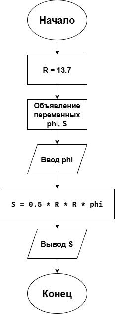

# Домашнее задание к работе 3
## Условие задачи
Написать и отладить программу расчета площади сектора, радиус которого равен 13.7, а дуга содержит заданное число радиан Ф.
## 1. Алгоритм и блок-схема
### Алгоритм решения
1. Начало
2. Объявить константу и переменные:
   - радиус: R = 13.7
   - угол: phi
   - площадь: S
3. Ввести значение переменной:
   - ввод значения угла phi
4. Вычислить площадь сектора:
   - S = 0.5 * R * R * phi
5. Вывести результаты расчетов с подстановкой всех значений в текст
6. Конец
### Блок-схема

## 2. Реализация программы
```
#include <stdio.h>
#include <locale.h>

int area()
{
	setlocale(LC_CTYPE, "RUS");

	const double R = 13.7;
	double phi;
	double S;

	printf("=============================================================\n");
	printf("Введите угол Ф в радианах:\n");
	scanf("%lf", &phi);
	printf("=============================================================\n");
	S = 0.5 * R * R * phi;
	printf("Исходные данные:\n");
	printf("Радиус R = %.1f\n", R);
	printf("Угол Ф = %.1f радиан\n", phi);
	printf("=============================================================\n");
	printf("Результат:\n");
	printf("Площадь сектора S = %.4f\n", S);
	printf("=============================================================\n");
}

int main()
{
	area();
	getchar();
	return 0;
}
```
## 3. Результат работы программы
```
=============================================================
Введите угол Ф в радианах:
12
=============================================================
Исходные данные:
Радиус R = 13.7
Угол Ф = 12.0 радиан
=============================================================
Результат:
Площадь сектора S = 1126.1400
=============================================================
```
## 4. Информация о разработчике
**Холодова Елизавета Юрьевна бИЦТ-262**
